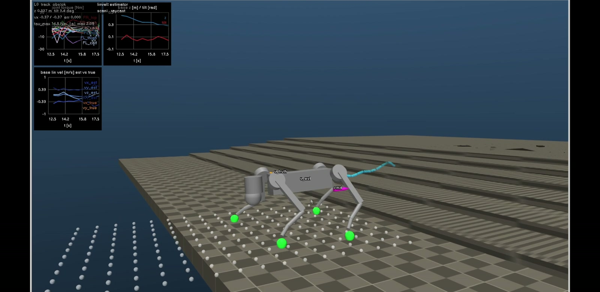
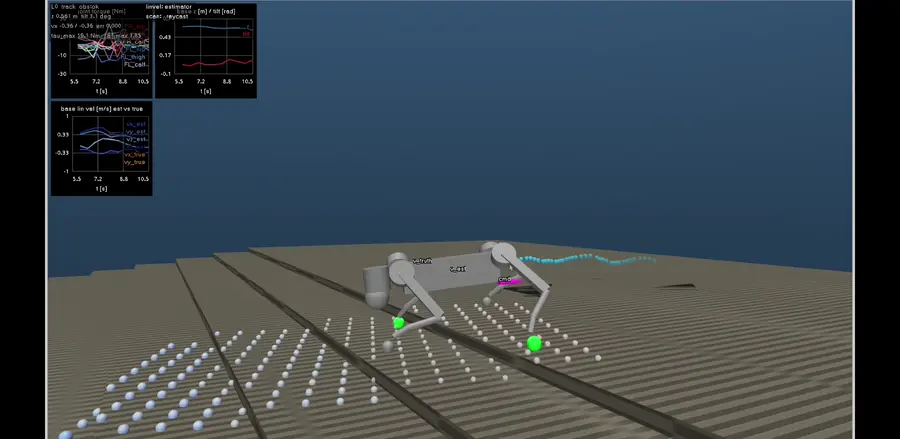
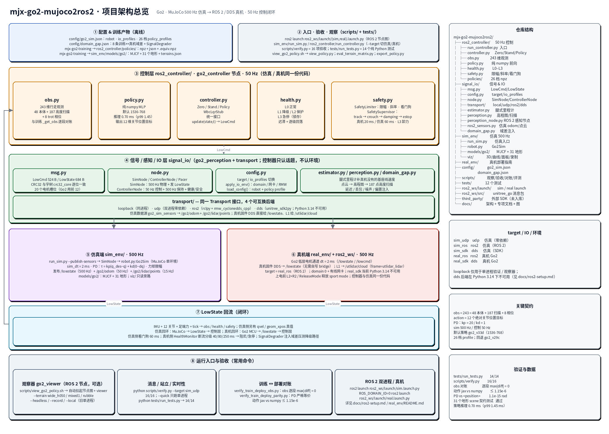
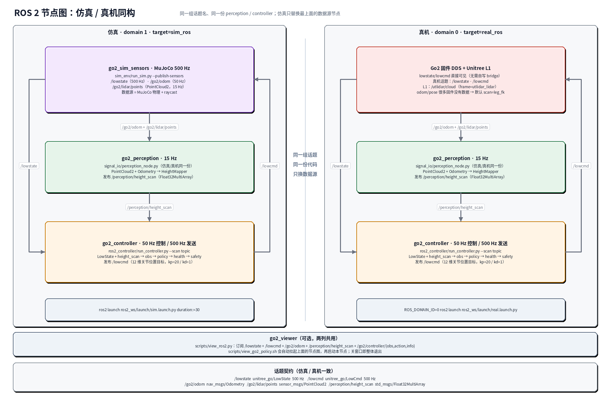
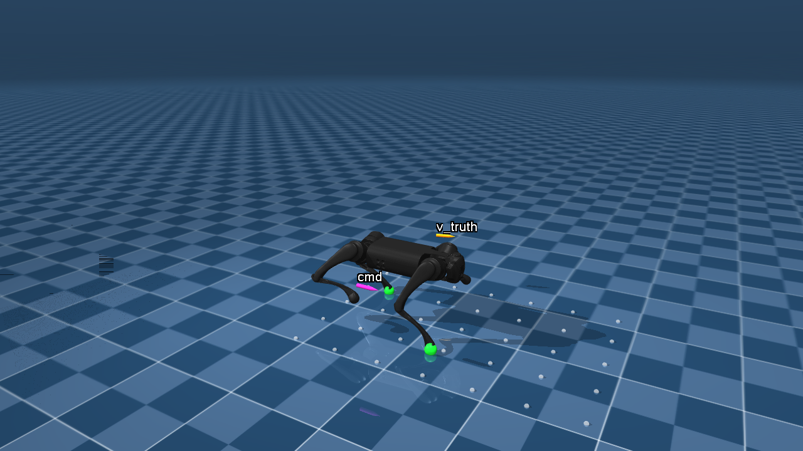
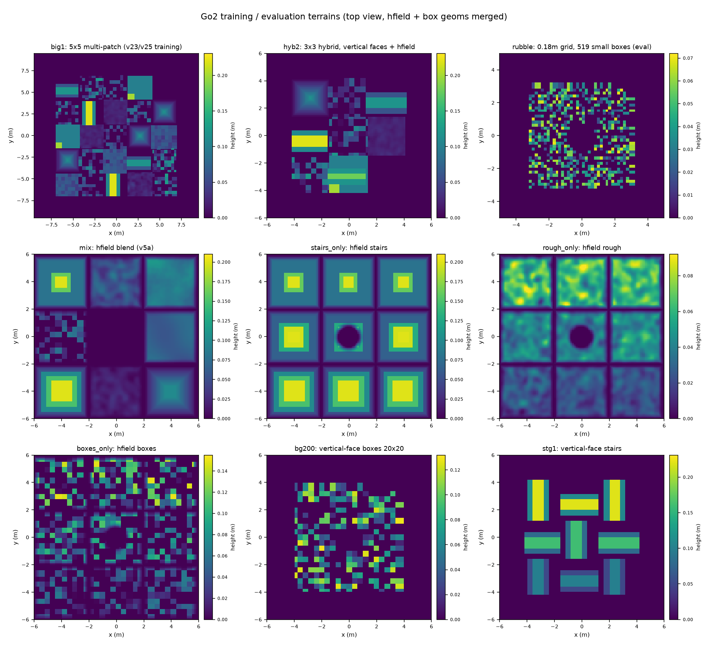

<div align="center">

# MJX Go2 Deploy

**Unitree Go2 的 MuJoCo 仿真 + ROS 2 / DDS 真机部署工程 —— 从训练策略到 500 Hz 电机闭环**

[](https://www.python.org/)
[](https://github.com/google-deepmind/mujoco)
[](https://docs.ros.org/)
[](LICENSE)
[](config/go2_sim.json)
[](tests/)

**纯 numpy 策略推理（不需要 JAX）· 50 Hz 控制 / 500 Hz 物理 · 31 个评测地形 · 训练-部署逐段对账**



<sub>默认策略 `go2_v33d`（1536-768 MLP，243 维观测）在观察器中：白色小球是观察器 raycast 真值，绿色是足端接触，左上角是跟踪/估计/状态曲线</sub>

</div>

---

> 训练（环境、PPO、检查点、地形生成、实验记录）在独立仓
> [**mjx-go2-training**](https://github.com/TC635807/mjx-go2-training)。
> 本仓只做「加载训练导出的模型 → 仿真 / 真机部署」。
> 训练仓的 Go2 策略训练到 20.97M 步后导出成 **286 KB 的 npz**，本仓用纯 numpy 前向在 CPU MuJoCo 里闭环，
> 再通过同一套控制器切换到 ROS 2 / DDS 真机。

<a id="toc"></a>

## 📋 目录

- [亮点](#highlights) · [演示](#demo)
- [架构](#architecture)：50 Hz 控制 + 500 Hz 物理
- [快速开始](#quickstart)：观察器 · 测试 · 验收
- [策略库](#policies) · [训练-部署一致性](#parity) · [评测结果](#results)
- [地形库](#terrains) · [观测/动作契约](#obs)
- [测试与验收](#tests) · [真机部署](#real)
- [仓库结构](#layout) · [与训练仓的关系](#training-repo) · [文档](#docs)

<a id="highlights"></a>

## ✨ 亮点

- **一套代码，仿真 / 真机同构**：`ros2_controller`（50 Hz）+ `signal_io`（loopback / udp / ros2 / dds 四种传输）
  + `sim_env`（500 Hz MuJoCo）/ `real_env`（Go2 真机），切换只改 `--target` 和网卡/domain。
- **部署不依赖 JAX**：策略是导出的 npz（权重 + `obs_layout` 元数据 + `.equiv.npz` 等价性样本），
  `ros2_controller/policy.py` 纯 numpy 前向；1536-768 策略单次推理 **0.70 ms（p99 1.45 ms）**，
  50 Hz 周期 20 ms，Jetson Orin Nano（40 TOPS）余量上千倍。
- **训练-部署逐位对账**：243 维观测 **逐段 max|diff| = 0**，12 维动作 jax vs numpy **max|diff| ≤ 1.15e-6**，
  `<position kp=20 kv=1>` 与部署 motor + PD **严格等价**（3 s 后 `max|Δq| = 1.1e-15 rad`）。
- **31 个评测地形**：真竖面台阶 / 箱体 / 碎石 + hfield 起伏 / 斜坡 / 混合；碰撞与视觉分离
  （渲染只剩 1 个视觉地形网格），WSLg 软件渲染下观察器 **RTF ≈ 1.0**。
- **26 档策略 profile**：默认 `auto → go2_v33d`（20.97M 步混合地形课程），
  回退 `go2_v29c`（hyb2 全命令最稳）/ `go2_v25b`，实验档 `v31c/d/e`、`v32/b`。
- **可观测性**：3D 扫描点 / 高度扫描热图 / 4 腿相位 / obs 分段仪表盘 / 跟踪曲线 / CSV 记录；
  健康层 L0-L3（含真机 lost/温度/bit_flag）、安全监督（限幅 / 斜率 / 阻尼 / 急停 / 断流保护）、
  退出阻尼收尾、域差注入（延迟 / 丢包 / 噪声 / 偏置）。

<a id="demo"></a>

## 🎬 演示

> 完整演示（70 s，720p，含台阶 / 箱体 / 碎石 / 平地）：
> ▶ [go2_v33d_demo_720p.mp4](https://github.com/TC635807/mjx-go2-training/blob/main/docs/assets/go2_v33d_demo_720p.mp4)



<sub>平地 + 缓坡：白色小球为观察器 raycast 的 3D 扫描点（真值对照），曲线为指令跟踪与线速度估计；
策略实际输入是 SimLidar + HeightMapper 生成的 187 点高度扫描（见下文「观测/动作契约」）</sub>

观察器界面与键盘：

| 键 | 功能 | 键 | 功能 |
|---|---|---|---|
| `W` / `S` | 前进速度 ±0.1 m/s | `A` / `D` | 转向 ±0.2 rad/s |
| `R` | 重置 | `空格` | 暂停 |
| `H` | 3D 叠加层 | `F` | 跟踪曲线 |
| `I` | 仪表盘 | `Q` | 退出 |

<a id="architecture"></a>

## 🏗 架构：50 Hz 控制 + 500 Hz 物理



<sub>图由 `scripts/make_architecture_diagram.py` 生成；可编辑源文件是
`docs/系统架构图.drawnix`；ROS 2 节点图由 `scripts/make_ros2_node_graph.py` 生成。
完整的模块职责、目录说明与扩展点见 [**docs/architecture.md**](docs/architecture.md)。</sub>

- **50 Hz 控制层**（`ros2_controller/`）：`obs.py` 构造 243 维观测 → `policy.py` 纯 numpy
  前向出 12 维关节位置目标 → `health.py` 分级 → `safety.py` 限幅/看门狗 → `LowCmd`。
- **500 Hz 电机层**（`signal_io/` + `sim_env/` / 真机）：保持最近一条 `LowCmd`、限斜率、
  限力矩。看门狗 `watchdog_ms` 只作用于**仿真侧** `SafetyLimiter`（掉 LowCmd 清零力矩）；
  真机侧靠 `HealthMonitor` 的 LowState 断流/NaN/姿态/电机健康分级 + `SafetySupervisor`
  切阻尼/急停（阈值见 `health_profiles`，真机 `stale 40 / protect 80 / estop 250 ms`）。
- **同一套 IO**：`loopback / udp / ros2 / dds` 四种传输，`--target` 决定打仿真还是真机。
- **PD**：`tau = kp·(q_des − q) + kd·(0 − dq)`，`kp = 20`、`kd = 1`，clamp 到力矩限幅
  （与训练侧 `<position kp=20 kv=1 forcerange>` 等价）。

### ROS 2 节点图：仿真 / 真机同构



仿真和真机启动同一张节点图，**只替换数据源节点**：仿真用 MuJoCo 发
`/lowstate` + 真值 `/go2/odom` + raycast `/go2/lidar/points`；真机直接用机器人固件
DDS（ROS 2 侧 `/lowstate` / `/lowcmd`，无需自写 bridge）+ L1 点云 `/utlidar/cloud`。
`go2_perception` 和 `go2_controller` 一行不改；真机默认 `scan:=leg_fk`（odom 不可靠时的安全档）。

```bash
# 仿真：sim_sensors + perception + controller
ros2 launch ros2_ws/launch/sim.launch.py duration:=30

# 真机：perception + controller；默认 controller=stand / scan=leg_fk（安全默认）
ROS_DOMAIN_ID=0 ros2 launch ros2_ws/launch/real.launch.py controller:=zero duration:=10
ROS_DOMAIN_ID=0 ros2 launch ros2_ws/launch/real.launch.py controller:=stand duration:=15
ROS_DOMAIN_ID=0 ros2 launch ros2_ws/launch/real.launch.py controller:=policy duration:=30
```

<a id="quickstart"></a>

## 🚀 快速开始

### 安装与自测

```bash
git clone https://github.com/TC635807/mjx-go2-mujoco2ros2.git
cd mjx-go2-mujoco2ros2
python -m venv .venv && source .venv/bin/activate
pip install -r requirements.txt

# 14 个纯 python 测试（消息/CRC/循环/观测/感知/估计/健康/安全/策略/可视化/地形契约）
python tests/run_tests.py

# 16 项验收（消息层 / IMU / PD / 双进程实时性；不需要真机）
python scripts/verify.py --target sim_udp
```

### 观察器（自动拉起 ROS 2 节点图）

观察器脚本会先启动 `sim_sensors + perception + controller` 三个 ROS 2 节点，
再启动只订阅话题的 `go2_viewer`；关窗口 / Ctrl-C 时一起退出。
没有 ROS 2 环境时用 `--local` 回到旧的单进程观察器。

```bash
# 默认 go2_v33d，平地
bash scripts/view_go2_policy.sh

# 常用地形
bash scripts/view_go2_policy.sh --terrain wide_h050     # 0.05 m 通宽楼梯
bash scripts/view_go2_policy.sh --terrain mixed1        # 5 条混合赛道（台阶+箱体+碎石）
bash scripts/view_go2_policy.sh --terrain rubble        # 519 块碎石
bash scripts/view_go2_policy.sh --terrain hyb2          # 3x3 混合（回归地形）
bash scripts/view_go2_policy.sh --list-terrains         # 列出 31 个地形

# 帧率/外观：隐藏机器人高模网格 + 限制同步频率
bash scripts/view_go2_policy.sh --robot-style lite --sync-hz 30

# 无 GUI / 录 CSV / 限定时长
bash scripts/view_go2_policy.sh --headless --record logs/go2_view
bash scripts/view_go2_policy.sh --duration 20

# 旧版单进程观察器（不启动 ROS 2 节点）
bash scripts/view_go2_policy.sh --local --terrain hyb2
```

> 没有桌面时用 `--headless`；WSLg / llvmpipe 软件渲染下建议 `--robot-style lite`，
> 实测 RTF 可从 0.31 提到 ≈1.0（见 `docs/go2-sim-fidelity.md §5.10`）。



### 单进程策略探针（不启动 viewer）

```bash
python scripts/probe_policy_controller.py --robot go2 --duration 12
```

<a id="policies"></a>

## 🎯 策略库

`config/go2_sim.json` 的 `policy_profiles` 里有 **26 档** Go2 策略（v2 → v33d）。
`policy_profile = auto` 按机器人选档，当前 `go2 → go2_v33d`：

| Profile | 网络 | 说明 |
|---|---|---|
| **`go2` → `go2_v33d`** | 1536-768 | **默认交付**：20.97M 步混合地形课程 + 70/30 混合命令 + 4 段 lr 衰减；台阶 0.03 m 上两级 98.4%、0.05 m 82.8%（存活 95.3%） |
| `go2_v29c` | 1024-512 | **回退档**：hyb2 全命令最稳（CPU 48 seed 91.7%），台阶 0.05 m 上两级 0% |
| `go2_v32b` | 1536-768 | 台阶专精前身：0.05 m 上两级 66.9%；全命令 hyb2 较弱 |
| `go2_v25b` | 1024-512 | v28 之前的交付 + 部署侧 port 回归测试参考 |
| `go2_v31c / v31d / v31e` | 1536-768 | 大网络 + 地形课程实验档（台阶专精 / 折中 / 证据档） |
| `go2_v20 / v24 / v28c / ...` | 1024-512 等 | 历史与实验档，用于 A/B 对照 |

```bash
PROFILE=go2_v33d bash scripts/view_go2_policy.sh --terrain wide_h050
PROFILE=go2_v29c bash scripts/view_go2_policy.sh --terrain hyb2
PROFILE=go2_v25b bash scripts/view_go2_policy.sh            # 回退
```

<a id="parity"></a>

## 🔬 训练-部署一致性

同一份契约在训练仓与部署仓各实现一次，用三个脚本钉死（细节见 `docs/go2-train-deploy-parity.md` 与
`docs/go2-sim-fidelity.md`）：

| 检查 | 脚本 | 结果 |
|---|---|---|
| 243 维观测逐段对账（含随机姿态 0.34 rad） | `scripts/verify_train_deploy_obs.py` | 修复 `projected_gravity` 符号 bug 后 **逐段 max\|diff\| = 0** |
| 12 维动作：jax(pkl) vs numpy(npz) | 同上 | **max\|diff\| ≤ 1.15e-6** |
| `<position kp=20 kv=1>` vs motor + PD | `scripts/verify_train_deploy_parity.py` | 1500 步后 **max\|Δq\| = 1.1e-15 rad**（严格等价） |
| 导出等价性（f32 highest vs f64） | `scripts/export_policy.py` | **max\|diff\| = 1.45e-6** → PASS |
| 部署物理 vs 训练物理（静止站姿） | `scripts/compare_deploy_vs_train_physics.py` | 只差 **0.7 mm** |

> 观测、执行器、物理参数逐项对齐后，剩下的域差（延迟 / 丢包 / 噪声 / 偏置）由
> `signal_io/domain_gap.py` 的 `SignalDegrader` 注入，用来在仿真里压测健康层与安全层。

<a id="results"></a>

## 📊 评测结果

### 地形存活（MJX 512 env × 6 s）

| 地形 | `go2_v29c` | **`go2_v33d`** |
|---|---|---|
| `hyb2` | 93.2% | **94.5%** |
| `stg1` | 83.9% | 82.0% |
| `bg200` | 85.4% | **87.8%** |
| `rubble` | 96.1% | **96.9%** |
| `wide_h050` | 81.5% | **97.1%** |
| `wide_h080` | **65.9%** | 35.2%（更激进，0.08 m 能上 34%） |

### 台阶能力（真竖面，128 env × 300 步）

| 地形 | 指标 | `go2_v29c` | **`go2_v33d`** |
|---|---|---|---|
| `wide_h030`（0.03 m） | 上 1 级 / 上 2 级 / 存活 | 84.7% / 15.3% / 96.9% | **100% / 98.4%** / 96.1% |
| `wide_h050`（0.05 m） | 上 1 级 / 上 2 级 / 存活 | 42.3% / 0% / 75.8% | **100% / 82.8% / 95.3%** |
| `lanes1`（0.03–0.11 m） | 上 2 级 | 14.1% | **99.0%** |

### 部署侧 CPU MuJoCo 闭环（48 seed）

| 指标 | `go2_v29c` | `go2_v32b` | **`go2_v33d`** |
|---|---|---|---|
| 总存活 | **87.5%** | 83.3% | 86.7%（噪声内） |
| 速度 / 位移 | 0.291 m/s / 3.72 m | 0.340 m/s / 4.45 m | **0.323 m/s / 4.23 m** |
| 髋 q p95 | 43.5/40.8/37.8/41.4° | 44.5/34.4/30.7/41.6° | **44.4/29.7/26.2/40.8°** |
| hyb2 / stg1 / big1 / rubble | **91.7** / 68.8 / **87.5** / 89.6% | 70.8 / 68.8 / 79.2 / 97.9% | 81.2 / **72.9** / 79.2 / **100.0%** |

> 结论：v33d 在 warp 地形与台阶上明显更好、部署速度更快、髋更收敛，但全命令 `hyb2` 略低于
> v29c（81.2% vs 91.7%）且 0.08 m 更激进。**默认 v33d，回退 v29c**——两档都保留。

<a id="terrains"></a>

## 🗺 地形库（31 个）

`sim_env/models/go2/terrains.json` 是地形清单（`--terrain` / 观察器 / 契约测试都读它）：

| 类别 | 地形 |
|---|---|
| 平地 / 基础 | `flat`、`mix`、`mix_hard`、`slope_only`、`rough_only`、`boxes_only`、`stairs_only` |
| 真竖面 / 混合 | `hyb1/2/3`、`big1`（5x5 大混合）、`bg200`（20x20 箱体场）、`rubble`（519 块碎石）、`stg1` |
| v28 台阶专项 | `stairs1/2`、`bands1`、`bands_u006/010/014/018/022` |
| v29 通宽楼梯 | `wide_h020/030/050/080/110/140`（0.02–0.14 m） |
| v32/v33 混合课程 | `mixed1`（5 条隔离赛道：台阶 + 箱体 + 碎石，riser 0.02–0.10 m） |



**地形资产三件套**：场景 XML（`include go2.xml`）+ hfield PNG（视觉）+ boxgrid JSON（高度表）。
地形文件由训练仓 `sim/export_deploy_terrains.py` 生成，本仓只消费：

- **视觉与碰撞分离**：hfield/视觉网格 `group=1`（raycast 可见、渲染可见）；
  碰撞盒/倾斜瓦片 `group=4`（物理与 raycast 可见、**渲染隐藏**），场景里再放 1 个统一材质的视觉网格。
  效果：`big1` 渲染可见 geom 从 3168 → 35，hyb2 794 → 35，观察器帧率从 RTF 0.31 恢复到 ≈1.0。
- **材质统一**：所有地形表面（hfield / 台阶 / 箱子）共用同一个 `groundplane` 材质 + 网格线纹理，
  消除「棕色突起 vs 同色地面」的视觉歧义。
- **raycast 语义**：观察器的白色扫描点、出生点地面探测、`height_scan` 都打到训练同款高度面；
  契约由 `tests/test_terrain_scenes.py` 守住（组掩码 `[1,1,0,0,1,0]`）。

<a id="obs"></a>

## 🔢 观测 / 动作契约

- **观测 243 维** = 48 本体（线速度×2、角速度×0.25、projected gravity、指令×2、
  关节位置−home、关节速度、上一帧动作）+ 187 高度扫描（17×11，x ∈ [−0.4, 1.2] m，y ∈ [−0.5, 0.5] m，
  `clip(z − h − 0.268, ±0.35) × 5`）+ 8 trot 相位（1.8 Hz）。
- **动作 12 维** = 12 个**绝对关节位置目标**，clamp 到 `ctrlrange`；部署侧 PD（kp = 20、kd = 1）
  转成力矩，500 Hz 零阶保持。
- **训练/部署共同约定**：`linvel_frame = body`（观测 0:3 是机体系速度）、出生高度 0.32 m、
  `scan.base = 0.268`、home 关节角 = 训练 keyframe 的 `ctrl`。
- 观测定义（唯一真相）：训练仓 `envs/go2_walk.py`；本仓的复刻在
  `ros2_controller/obs.py` + `signal_io/perception.py`，对账脚本见上文。

<a id="tests"></a>

## ✅ 测试与验收

| 项目 | 命令 | 结果 |
|---|---|---|
| 单元测试（纯 python，无 pytest） | `python tests/run_tests.py` | **14/14 通过** |
| 消息/IMU/PD/双进程实时性验收 | `python scripts/verify.py --target sim_udp` | **16/16 通过** |
| 观测/动作对账 | `python scripts/verify_train_deploy_obs.py` | obs 逐段 0、动作 ≤1.15e-6 |
| 物理等价性 | `python scripts/verify_train_deploy_parity.py --mode all` | 执行器严格等价 |
| ROS 2 节点图（仿真） | `ros2 launch ros2_ws/launch/sim.launch.py` | sim_sensors + perception + controller 三节点闭环 |
| 真机 LowCmd CRC（812 B 布局） | `python tests/test_go2_crc.py` | 4 组官方向量 + `crc_amd64.so` 逐字节一致 |

覆盖：消息 CRC、观测布局与符号、LiDAR 感知与高程图、腿式里程计、健康层 L0-L3、安全监督、
策略前向（含 `.equiv.npz` 回归）、可视化面板、地形碰撞契约。

<a id="real"></a>

## 🤖 ROS 2 / DDS / 真机

| target | 依赖 | 用途 |
|---|---|---|
| `sim_udp` | 无 | 本机双进程仿真（裸 UDP，零中间件依赖） |
| `sim_ros` | 系统 ROS 2 + `ros2_ws` | 与真机同构的 ROS 2 话题闭环 |
| `sim_sdk` | `unitree_sdk2py` + cyclonedds | 官方 SDK 仿真（Python 3.14 暂不可用） |
| `real_ros` | `rclpy` + `unitree_go` 消息包 | Go2 真机（ROS 2 话题 `/lowstate` / `/lowcmd`） |
| `real_sdk` | `unitree_sdk2py` + cyclonedds | Go2 真机（官方 SDK，domain 0 + 有线网卡；Python 3.14 暂不可用） |

```bash
# ROS 2 节点图（需要本机 ROS 2，见 docs/ros2-setup.md）
source /opt/ros/<distro>/setup.bash && source ros2_ws/install/setup.bash
ros2 launch ros2_ws/launch/sim.launch.py duration:=30
ros2 launch ros2_ws/launch/sim.launch.py duration:=20 viewer:=true   # 带观察器节点
# 或旧的两进程 demo（无独立感知节点，控制器回退 leg_fk）
./scripts/demo_ros2_policy.sh 12 go2 sim_clean

# 真机：先只读自检（不发送任何指令），再吊起来 zero -> stand -> policy
scripts/run_with_ros2.sh scripts/go2_real_check.py --target real_ros --duration 5
ROS_DOMAIN_ID=0 ros2 launch ros2_ws/launch/real.launch.py controller:=zero duration:=10
ROS_DOMAIN_ID=0 ros2 launch ros2_ws/launch/real.launch.py controller:=stand duration:=15
ROS_DOMAIN_ID=0 ros2 launch ros2_ws/launch/real.launch.py controller:=policy duration:=30
# 手动起控制器（没有可靠 odom 时自动回退 leg_fk）
scripts/run_with_ros2.sh ros2_controller/run_controller.py --target real_ros \
    --controller policy --policy-profile go2_v33d --scan leg_fk --linvel estimator --duration 20
```

> 真机前必读：[`real_env/README.md`](real_env/README.md)（网络 / domain / 释放 sport mode /
> CRC / 上电顺序 / 高度扫描风险 / 已知边界 checklist）。
> `go2_real_check.py` 只订阅不发布：确认 `/lowstate` 频率、电机 mode、`/lowcmd` 是否有
> 别的进程占用且 CRC 合法、L1 点云 frame/频率、odom 是否有数据。
> 本仓不 vendor 第三方 SDK（`third_party/` 与 `ros2_ws/build|install|log` 未入库），
> 获取方式见 `docs/ros2-setup.md`。

<a id="layout"></a>

## 🗂 仓库结构

```text
mjx-go2-mujoco2ros2/
├── ros2_controller/            # 50 Hz 控制层（run_controller / controller / obs / policy / health / safety）
│   └── policies/               # 26 档 profile 的部署产物：npz 权重 + json 元数据 + 可选 .equiv.npz
├── signal_io/                  # 消息、IO profile、节点、传输、估计器、感知、ROS2 传感器桥、域差注入
│   ├── go2_crc.py              #   真机 LowCmd 812B 布局 + CRC32（官方向量回归）
│   ├── perception_node.py      #   ROS 2 感知节点（点云 -> height_scan）
│   ├── ros2_sensors.py         #   仿真侧 odom + PointCloud2 发布
│   └── ros2_debug.py           #   控制器 obs/action/info 调试发布
├── sim_env/                    # 500 Hz MuJoCo 仿真（Go2Sim）+ 31 个地形场景 + 可视化
│   ├── models/go2/             # go2.xml + scene*.xml + assets/ + terrains.json
│   └── viz/                    # frame / scene / panels / live / record
├── real_env/                   # 真机部署指南（real_ros / real_sdk）
├── config/                     # go2_sim.json（物理/IO/策略/安全/感知）+ domain_gap.json
├── scripts/                    # 观测入口（自动拉起 ROS2）/ 真机自检 / 验收 / 导出 / 对账 / 评测 / 架构图
├── tests/                      # 14 个纯 Python 测试
├── docs/                       # architecture / ros2-setup / results / parity / fidelity / viz + 架构图
├── ros2_ws/launch/             # sim.launch.py / real.launch.py（ROS 2 节点图）
├── ros2_ws/src/unitree_go/     # ROS 2 消息包（build/install 未入库）
├── third_party/                # 外部 SDK（未入库）
└── requirements.txt
```

<a id="training-repo"></a>

## 🧩 与训练仓的关系

两个仓**没有包级依赖**，耦合是「训练产物单向导出 + 同一契约两侧各实现一次」：

| 方向 | 内容 | 本仓落点 |
|---|---|---|
| 训练 → 部署 | 策略 `pkl → npz`（含 `.json` 元数据、`.equiv.npz` 等价样本） | `ros2_controller/policies/` |
| 训练 → 部署 | 31 个地形场景 XML + hfield PNG + 视觉 OBJ + `terrains.json` | `sim_env/models/go2/` |
| 训练 → 部署 | 机器人物理参数（`go2_mjx_position.xml` ↔ 本仓 `go2.xml` + PD） | 对账脚本 |
| 部署 → 训练 | 审计脚本回读训练仓（`eval_go2.py`、训练 XML/pkl） | `scripts/verify_train_deploy_obs.py` 等 |

重新导出策略 / 地形（在训练仓）：

```bash
bash sim/export_deploy_policy.sh models/go2_v33d_20m_logs/checkpoints/best v33d
python sim/export_deploy_terrains.py
```

<a id="docs"></a>

## 📚 文档

| 文档 | 内容 |
|---|---|
| [`docs/architecture.md`](docs/architecture.md) | **架构总览**：分层、数据流、模块职责、目录结构、IO matrix、扩展点 |
| [`docs/ros2-setup.md`](docs/ros2-setup.md) | ROS 2 / CycloneDDS 安装、`unitree_go` 构建、双进程运行、真机切换 |
| [`docs/results.md`](docs/results.md) | 测试 / 验收 / 性能拆账 / 后端状态 / 地形评测 |
| [`docs/go2-train-deploy-parity.md`](docs/go2-train-deploy-parity.md) | 训练 ↔ 部署一致性：执行器、观测/动作、物理参数与残余差异 |
| [`docs/go2-sim-fidelity.md`](docs/go2-sim-fidelity.md) | 仿真保真度排查记录：帧率、`projected_gravity`、hfield 接触、地形视觉 |
| [`docs/viz.md`](docs/viz.md) | 观察器（自动拉起 ROS 2 节点图）使用、参数与实现 |
| [`real_env/README.md`](real_env/README.md) | 真机 Go2 部署：网络/domain、释放 sport mode、CRC、上电顺序、安全、高度扫描风险 |
| [`docs/go2-sim2real-references.md`](docs/go2-sim2real-references.md) | Go2 sim2real 实战项目调研（真机跑通的项目、通信/网络/雷达/安全做法与坑） |

<a id="license"></a>

## 📜 许可与致谢

MIT License © 2026 TC635807，见 [LICENSE](LICENSE)。

架构与消息层参考 [unitree_mujoco](https://github.com/unitreerobotics/unitree_mujoco)、
[unitree_ros2](https://github.com/unitreerobotics/unitree_ros2)、
[unitree_sdk2](https://github.com/unitreerobotics/unitree_sdk2)；
Go2 模型来自 [mujoco_menagerie](https://github.com/google-deepmind/mujoco_menagerie)；
训练侧见 [mjx-go2-training](https://github.com/TC635807/mjx-go2-training)。

如果这个项目对你有帮助，欢迎 ⭐ Star 或提 Issue。
