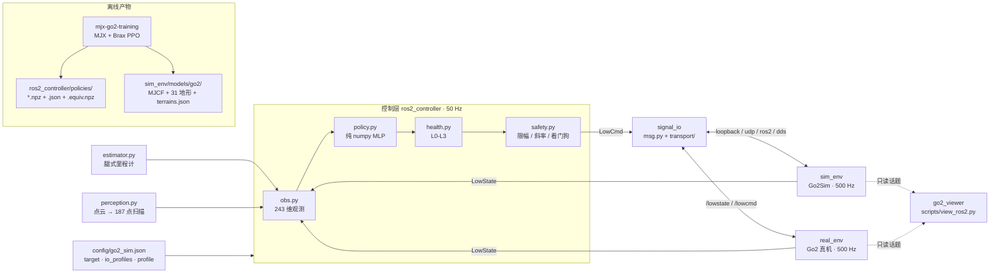

# 架构：MuJoCo(Go2) ↔ ROS 2 / DDS 真机

> 本文件是项目结构的唯一权威说明。图由 `scripts/make_architecture_diagram.py` 生成，
> 可编辑源文件在 `docs/系统架构图.drawnix`。


## 0. 一句话

MuJoCo 里跑一台 Go2：500 Hz 物理/电机层收 `LowCmd`、发 `LowState`（ROS 2 下即
`/lowcmd` / `/lowstate`），50 Hz 控制层算 12 个关节目标；**仿真和真机共用同一套消息、
传输、控制器与安全层**，切换只改 `--target`（以及真机的 domain / 网卡）。

## 1. 设计原则

1. **控制与物理分层**：50 Hz 控制层只负责"算出这一拍的 12 个目标"；500 Hz 电机层负责保持、
   限幅、看门狗。真机底层 low-level 通道是 500 Hz（`dt = 0.002`），仿真按同一时序实现。
2. **控制器不认环境**：控制器只认 `LowState`，只吐 `LowCmd`；环境差异全部下沉到
   `signal_io/transport/` 和 `config/go2_sim.json` 的 `io_profiles`。
3. **部署不依赖 JAX**：训练仓导出的策略是纯 numpy `npz`（权重 + `obs_layout` 元数据 +
   `.equiv.npz` 等价样本），`ros2_controller/policy.py` 直接前向。
4. **契约单点**：观测布局 / 动作语义 / 物理参数在训练仓与本仓各实现一次，由
   `scripts/verify_train_deploy_obs.py` 与 `scripts/verify_train_deploy_parity.py` 逐段对账
   （当前 obs 逐段 `max|diff| = 0`，动作 `≤ 1.15e-6`，执行器 `1.1e-15 rad`）。

## 2. 运行时数据流



## 2.1 ROS 2 节点图（仿真 / 真机同构）


<sub>图由 `scripts/make_ros2_node_graph.py` 生成。</sub>

- **仿真**：`go2_sim_sensors` = `sim_env/run_sim.py --publish-sensors`，把 MuJoCo 的
  500 Hz 状态发布成 `/lowstate`，并把真值 `/go2/odom`、raycast 点云
  `/go2/lidar/points` 发出来。
- **真机**：低层状态/指令直接来自机器人固件 DDS（ROS 2 侧 `/lowstate` / `/lowcmd`，
  不需要自写 bridge）；L1 点云 `/utlidar/cloud`、odom/pose 视固件而定。
  `go2_perception` 与 `go2_controller` **一行不改**；真机默认 `scan:=leg_fk`（odom 不可靠）。
- **控制器**：`run_controller.py --scan topic` 订阅 `/perception/height_scan`；在没有
  扫描数据时回退 `leg_fk`，不会因为感知节点晚启动而报错。
- **观察器**：`go2_viewer`（`scripts/view_ros2.py`）是可选的 ROS 2 节点，只订阅
  `/lowstate`、`/lowcmd`、`/go2/odom`、`/perception/height_scan`、
  `/go2/controller/{obs,action,info}`，不接触仿真/控制器内部对象。仿真和真机共用。
- **一键观察**：`bash scripts/view_go2_policy.sh` 自动启动整张节点图 + viewer；
  `--local` 回退旧的单进程观察器。
- **launch**：`ros2 launch ros2_ws/launch/sim.launch.py`（仿真）/
  `ros2 launch ros2_ws/launch/real.launch.py`（真机）；加 `viewer:=true` 会启动
  `go2_viewer`。

## 3. 分层职责

| 层 | 目录 | 关键文件 | 职责 |
|---|---|---|---|
| 控制层 (50 Hz) | `ros2_controller/` | `run_controller.py` / `controller.py` / `obs.py` / `policy.py` / `health.py` / `safety.py` | 观测构造、策略推理、控制器接口、健康分级、安全监督与指令下发 |
| 信号 / IO | `signal_io/` | `msg.py` / `config.py` / `node.py` / `transport/` / `estimator.py` / `perception.py` / `perception_node.py` / `ros2_sensors.py` / `domain_gap.py` | 消息与 CRC、IO profile、SimNode/ControllerNode、四种传输、腿式里程计、高程图、仿真传感器桥、域差注入 |
| 仿真 (500 Hz) | `sim_env/` | `run_sim.py` / `robot.py` / `models/go2/` / `viz/` | MuJoCo 单环境仿真、PD 与力矩限幅、31 个地形、观察器组件；`--publish-sensors` 时兼做 ROS 2 数据源 |
| 真机 | `real_env/` + `ros2_ws/` | `real_env/README.md` / `ros2_ws/src/unitree_go/` / `ros2_ws/launch/` | 真机部署指南、ROS 2 消息包、仿真/真机 launch（`build/install` 不入库） |
| 配置 | `config/` | `go2_sim.json` / `domain_gap.json` | 机器人、IO profile、26 档策略、safety/health/perception、域差清单 |
| 工具 | `scripts/` | `view_policy.py` / `verify.py` / `export_policy.py` / `verify_train_deploy_*.py` / `eval_terrain_matrix.py` | 观察器、验收、导出、训练↔部署对账、地形评测、架构图生成 |
| 测试 | `tests/` | `tests/run_tests.py` + 12 个 `test_*.py` | 纯 Python 契约测试（消息/观测/感知/估计/健康/安全/策略/可视化/地形） |

## 4. 50 Hz / 500 Hz 时序

```
sim/真机侧 (500 Hz, dt = 2 ms)          控制侧 (50 Hz 控制 + 500 Hz 发送)
──────────────────────────────          ──────────────────────────────
收到 LowCmd → 安全层 → 施加力矩          每 2 ms：收最新 LowState、发最近一条 LowCmd
→ 物理一步 → 发 LowState                每 20 ms：obs → policy → health → safety → 新 LowCmd
```

- **500 Hz 层**：保持最近一条 `LowCmd`，按 N·m/s 限斜率、按关节夹力矩；仿真侧看门狗
  （`watchdog_ms`；真机侧是 HealthMonitor 的 LowState 断流分级，见 §6 安全层）
  60 ms、真机 20 ms。
- **50 Hz 层**：`obs.py` 构造 243 维观测 → `policy.py` 输出 12 维关节位置目标 →
  `health.py` 给 L0-L3 → `safety.py` 映射成 track / crouch / damping / estop。
- **PD**：`tau = kp·(q_des − q) + kd·(0 − dq)`，`kp = 20`、`kd = 1`，再按关节力矩上限
  （hip/thigh 23.7、calf 45.43 N·m）夹紧；与训练侧 `<position kp=20 kv=1 forcerange>` 等价。

## 5. IO 后端与 target

| target | 传输 | 用途 | 依赖 |
|---|---|---|---|
| `sim_udp` | `udp` | 本机双进程仿真 | 无 |
| `sim_ros` | `ros2` | 与真机同构的 ROS 2 仿真 | ROS 2 + `ros2_ws` |
| `sim_sdk` | `dds` | 官方 SDK 风格的仿真 | `unitree_sdk2py` + cyclonedds |
| `real_ros` | `ros2` | Go2 真机（ROS 2 话题） | ROS 2 + `unitree_go` |
| `real_sdk` | `dds` | Go2 真机（官方 SDK） | `unitree_sdk2py` + cyclonedds |

`loopback` 是另一种传输实现，用于单进程验证与观察器。当前 Python 3.14 环境下
`dds` 后端不可用（cyclonedds Python 绑定与 PEP 649 冲突，见 `docs/ros2-setup.md`）；
ROS 2 路径已验证。

推荐直接跑与真机同构的 ROS 2 节点图：

```bash
# 仿真：sim_sensors + perception + controller 三个节点
ros2 launch ros2_ws/launch/sim.launch.py duration:=30

# 真机：perception + controller（直接订阅机器人 DDS；默认 stand + leg_fk 安全档）
ROS_DOMAIN_ID=0 ros2 launch ros2_ws/launch/real.launch.py controller:=zero duration:=10
ROS_DOMAIN_ID=0 ros2 launch ros2_ws/launch/real.launch.py controller:=stand duration:=15
```

不使用 launch 时也可以手工起进程：

```bash
python sim_env/run_sim.py --target sim_udp --duration 20
python ros2_controller/run_controller.py --target sim_udp --controller policy --duration 20
```

## 6. 观测 / 动作契约

- **观测 243 维** = 48 本体 + 187 高度扫描（17×11）+ 8 trot 相位。
  - 0:48：线速度×2、角速度×0.25、projected gravity、指令×2、关节位置−home、关节速度、上一帧动作。
  - 48:235：`17×11` 高度扫描，`clip(z_base − h_ground − 0.268, ±0.35) × 5`。
  - 235:243：`cos/sin` 四腿相位（1.8 Hz）。
- **动作 12 维** = 12 个绝对关节位置目标，clamp 到训练关节范围，部署侧 PD 转力矩。
- **观测定义唯一真相**：训练仓 `envs/go2_walk.py`；本仓复刻在
  `ros2_controller/obs.py` + `signal_io/perception.py`。
- **默认策略**：`go2_v33d`（1536-768，20.97M 步混合地形课程，243 维 obs，纯 numpy
  单次推理 0.70 ms / p99 1.45 ms）；共 26 档 profile，回退 `go2_v29c`。

## 7. 仓库结构

```text
mjx-go2-mujoco2ros2/
├── ros2_controller/            # 50 Hz 控制层
│   ├── run_controller.py       #   控制侧入口（--target 切 IO）
│   ├── controller.py           #   Zero / Stand / Policy / WbcLqrStub
│   ├── obs.py                  #   243 维观测
│   ├── policy.py               #   纯 numpy MLP 前向
│   ├── health.py               #   L0-L3 健康分级
│   ├── safety.py               #   限幅 / 斜率 / 看门狗 / 安全监督
│   └── policies/               #   26 档 npz + json + .equiv.npz
├── signal_io/                  # 信号与 IO 层
│   ├── msg.py                  #   LowCmd / LowState + CRC32
│   ├── config.py               #   target / io_profiles / profile 合并
│   ├── node.py                 #   SimNode / ControllerNode / Pacer
│   ├── transport/              #   loopback / udp / ros2 / dds
│   ├── estimator.py            #   腿式里程计
│   ├── perception.py           #   点云 -> 高程图 -> 187 点扫描
│   ├── perception_node.py      #   ROS 2 感知节点
│   ├── ros2_sensors.py         #   仿真侧 odom + PointCloud2 发布
│   ├── ros2_debug.py           #   控制器 obs/action/info 调试发布
│   └── domain_gap.py           #   域差清单 + 信号降级注入
├── sim_env/                    # 500 Hz MuJoCo 仿真
│   ├── run_sim.py              #   仿真侧入口（--publish-sensors 兼做 ROS 2 数据源）
│   ├── robot.py                #   Go2Sim（模型 / PD / LowState）
│   ├── models/go2/             #   MJCF + 31 个地形 + assets
│   └── viz/                    #   frame / scene / panels / live / record
├── real_env/                   # 真机部署指南（入口 README）
├── config/                     # go2_sim.json / domain_gap.json
├── scripts/                    # 观察 / 验收 / 导出 / 对账 / 评测
│   ├── view_go2_policy.sh      #   自动 launch + viewer 的观测入口
│   ├── view_go2_policy_local.sh #   旧单进程观察器
│   └── view_ros2.py            #   go2_viewer ROS 2 节点
├── tests/                      # 12 个纯 Python 测试
├── ros2_ws/
│   ├── launch/                 #   sim.launch.py / real.launch.py
│   └── src/unitree_go/         #   ROS 2 消息包（build/install 不入库）
├── third_party/                # 外部 SDK（未入库）
└── docs/                       # 本文档 + 专项文档 + 架构图
```

## 8. 扩展点

| 想做的事 | 改哪里 |
|---|---|
| 换控制器（LQR / MPC / 状态机） | 在 `ros2_controller/controller.py` 实现 `update(state, t) -> LowCmd` |
| 加一种传输 | 在 `signal_io/transport/` 实现 4 个方法，并在 `make_transport()` 注册 |
| 接新机器人 / 新机型 | 加 `config/go2_sim.json` 的 `robots.<name>` + 模型目录，控制器无需改 |
| 换策略 | `config/go2_sim.json` 的 `policy_profiles` 加档，或 `--policy-profile` 指定 |
| 真机点云接入 | `perception_node.py --points-topic /utlidar/cloud --points-frame lidar --odom-type pose`；需先标定 L1 外参/轴向，无 odom 时回退 `leg_fk` |
| 替换机器人 / 传感器 | 只替换数据源节点（仿真 `sim_env/run_sim.py`，真机 = 机器人固件 DDS），下游话题名保持一致 |

## 9. 相关文档

- [README](../README.md) —— 快速开始、策略库、评测结果
- [docs/ros2-setup.md](ros2-setup.md) —— ROS 2 / CycloneDDS 环境与双进程运行
- [docs/results.md](results.md) —— 验收结果、性能拆账、后端状态
- [docs/go2-train-deploy-parity.md](go2-train-deploy-parity.md) —— 训练↔部署物理一致性
- [docs/go2-sim-fidelity.md](go2-sim-fidelity.md) —— 仿真保真度排查记录
- [docs/viz.md](viz.md) —— 观察器使用与接口
- [real_env/README.md](../real_env/README.md) —— 真机部署 checklist
