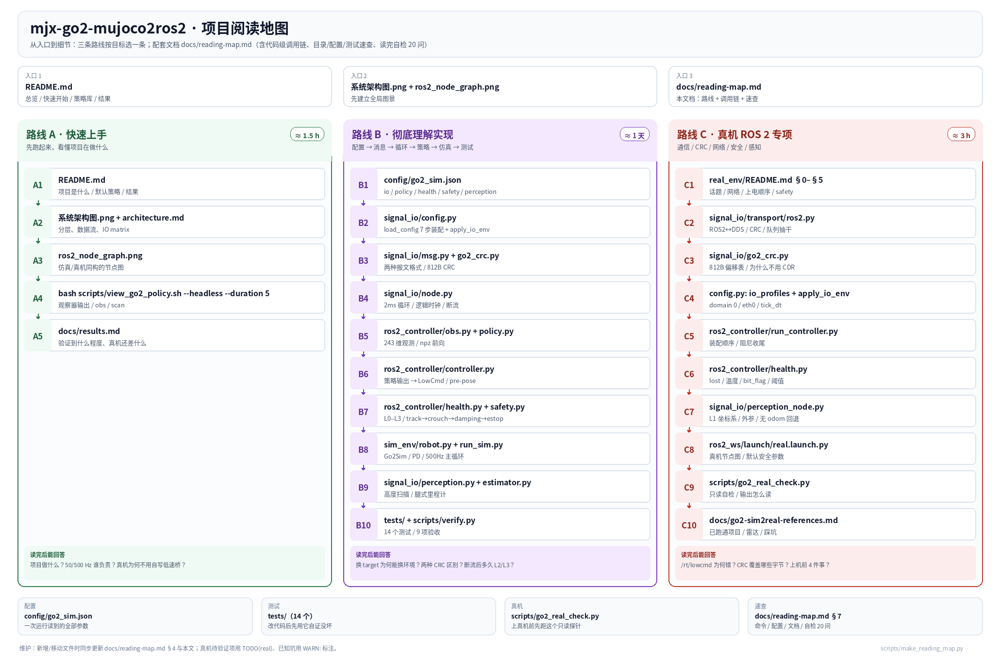

# 项目阅读地图（从入口到细节）

> 目标：让你**按一条确定的路径**把项目读懂，而不是在 60+ 个文件里乱翻。
> 本文按"先全景、再选路线、最后按图索骥"组织；每条路线都给了阅读顺序、
> 每步要理解什么、以及读完后应该能回答的检查点问题。

图由 [scripts/make_reading_map.py](../scripts/make_reading_map.py) 生成；改路线/文件后重新运行即可更新。
横向看是三条路线（A 快速上手 / B 彻底理解实现 / C 真机 ROS 2 专项），
纵向看是每条的阅读顺序；底部是配置/测试/真机/速查四个入口。

---

## 0. 一分钟总览

这个项目做三件事：

1. **训练产物 → 部署**：加载训练仓导出的 npz 策略（纯 numpy 前向），在 MuJoCo 里闭环；
2. **仿真**：50 Hz 策略 + 500 Hz 电机层，31 个评测地形，观察器可视化；
3. **真机**：同一份控制代码，通过 ROS 2（rclpy + rmw_cyclonedds_cpp）直接和 Go2 固件
   的 DDS 话题 /lowstate、/lowcmd 通信，500 Hz 零阶保持下发带 CRC 的 LowCmd。

一句话架构：**业务代码不认中间件，只认 Transport；仿真/真机只差 --target。**

~~~
                         ┌─────────────────────────────────────────────┐
                         │        ros2_controller/  50 Hz 策略层        │
                         │  obs.py → policy.py → health.py → safety.py │
                         └───────────────────┬─────────────────────────┘
                                             │ LowCmd / LowState（内部纯 Python 消息）
                         ┌───────────────────▼─────────────────────────┐
                         │     signal_io/  消息 / IO / 控制循环         │
                         │  msg.py  config.py  node.py  transport/*     │
                         │  estimator.py  perception.py  go2_crc.py     │
                         └───────┬───────────────┬───────────────┬─────┘
                                 │               │               │
                    ┌────────────▼───┐   ┌───────▼──────┐  ┌─────▼──────────┐
                    │ sim_env/ 500Hz │   │ ROS 2 话题   │  │ 真机 Go2 固件  │
                    │ MuJoCo + 地形  │   │ /lowstate    │  │ DDS rt/lowstate│
                    │ + 可视化       │   │ /lowcmd      │  │ rt/lowcmd      │
                    └────────────────┘   └──────────────┘  └────────────────┘
~~~

三类进程（都在 signal_io/node.py 里）：

| 进程 | 代码 | 作用 |
|---|---|---|
| 数据源（仅仿真） | sim_env/run_sim.py → SimNode | 500 Hz 物理 + 发 LowState + 收 LowCmd |
| 控制器 | ros2_controller/run_controller.py → ControllerNode | 50 Hz 策略 + 500 Hz 下发 + 健康/安全 |
| 观察器（可选） | scripts/view_ros2.py（ROS 2 节点）/ scripts/view_policy.py（旧单进程） | 只订阅话题，不参与控制 |

---

## 1. 三条阅读路线（按你的目标选一条）

### 路线 A：先"跑起来 + 看懂架构"（约 1.5 小时）

适合：想快速理解项目做了什么、怎么用、结果如何。

| 步骤 | 读什么 | 重点 | 读完后应该能回答 |
|---|---|---|---|
| A1 | [README.md](../README.md) | 亮点、架构图、快速开始、策略库、结果 | 这个项目解决什么问题？默认策略/地形是什么？ |
| A2 | [docs/assets/系统架构图.png](assets/系统架构图.png) + [docs/architecture.md](architecture.md) | 分层、数据流、模块职责、IO matrix | 50 Hz 和 500 Hz 分别谁在做什么？ |
| A3 | [docs/assets/ros2_node_graph.png](assets/ros2_node_graph.png) + [docs/architecture.md](architecture.md) §2.1 | 仿真/真机同构的 ROS 2 节点图 | 真机为什么不需要自己写 lowstate/lowcmd 桥？ |
| A4 | 跑一次：bash scripts/view_go2_policy.sh --headless --duration 5 | 观察器输出、obs 243 维、scan 187 点 | 策略输入输出各是什么？ |
| A5 | [docs/results.md](results.md) | 测试、性能、地形评测 | 现在验证到什么程度？真机还差什么？ |

### 路线 B：彻底理解实现（约 1 天，推荐）

适合：要改代码、加功能、做二次开发。

按"配置 → 消息 → 循环 → 策略 → 仿真/感知 → 安全 → 测试"顺序：

| 步骤 | 读什么 | 重点 | 读完后应该能回答 |
|---|---|---|---|
| B1 | [config/go2_sim.json](../config/go2_sim.json) | io_profiles / policy_profiles / health / safety / perception | 一次运行到底读哪些配置？ |
| B2 | [signal_io/config.py](../signal_io/config.py) | load_config 的 7 步装配；apply_io_env | 为什么换 --target 就能换环境？环境变量为什么必须在 rclpy.init 前设？ |
| B3 | [signal_io/msg.py](../signal_io/msg.py) + [signal_io/go2_crc.py](../signal_io/go2_crc.py) | 内部消息、两种报文格式（本地 524B / 真机 812B）、CRC | 本地 CRC 和真机 CRC 为什么不能互换？ |
| B4 | [signal_io/node.py](../signal_io/node.py) | SimNode / ControllerNode 的 2 ms 循环、时钟、断流 | 没收到 LowState 时程序会怎样？断流后 health 为什么能升级？ |
| B5 | [ros2_controller/obs.py](../ros2_controller/obs.py) + [ros2_controller/policy.py](../ros2_controller/policy.py) | 243 维观测布局、npz 前向 | 观测每一段是什么？动作是什么？ |
| B6 | [ros2_controller/controller.py](../ros2_controller/controller.py) | BaseController / PolicyController / Stand / Zero | 策略输出如何变成 LowCmd？pre-pose 做什么？ |
| B7 | [ros2_controller/health.py](../ros2_controller/health.py) + [ros2_controller/safety.py](../ros2_controller/safety.py) | L0–L3、track/crouch/damping/estop | 什么情况会切阻尼？什么情况会急停锁存？ |
| B8 | [sim_env/robot.py](../sim_env/robot.py) + [sim_env/run_sim.py](../sim_env/run_sim.py) | Go2Sim、PD/力矩限幅、500 Hz 主循环 | MuJoCo 里执行器/关节顺序怎么对应真机？ |
| B9 | [signal_io/perception.py](../signal_io/perception.py) + [signal_io/estimator.py](../signal_io/estimator.py) | HeightMapper、SimLidar、腿式里程计 | 高度扫描和线速度在真机上从哪来？ |
| B10 | [tests/](../tests/) + [scripts/verify.py](../scripts/verify.py) | 14 个测试 + 9 项验收 | 改代码后怎么自证没坏？ |

### 路线 C：真机 ROS 2 专项（约 3 小时，重点）

适合：准备上真机 / 排查真机通信问题。完整清单也写在
[real_env/README.md](../real_env/README.md) §11。

| 步骤 | 读什么 | 重点 | 读完后应该能回答 |
|---|---|---|---|
| C1 | [real_env/README.md](../real_env/README.md) §0–§5 | 话题、网络、上电顺序、safety | 上真机前必须做哪 4 件事？ |
| C2 | [signal_io/transport/ros2.py](../signal_io/transport/ros2.py) | ROS 2 名 ↔ DDS 名、_on_state、_to_ros_cmd、_cmd_crc、_spin_to_latest | /lowcmd 写错成 /rt/lowcmd 会怎样？CRC 覆盖哪些字节？ |
| C3 | [signal_io/go2_crc.py](../signal_io/go2_crc.py) | 812B 偏移表、为什么不能用 CDR/zlib | 真机固件如何判断"这条指令有效"？ |
| C4 | [signal_io/config.py](../signal_io/config.py) 的 io_profiles + apply_io_env | domain 0、eth0、tick_dt=0.001、CYCLONEDDS_URI | 多网卡机器为什么必须绑网卡？ |
| C5 | [ros2_controller/run_controller.py](../ros2_controller/run_controller.py) | 装配顺序（配置→env→transport→scan→控制器→健康→循环→阻尼收尾） | 程序退出时为什么先发 100 ms 阻尼？ |
| C6 | [ros2_controller/health.py](../ros2_controller/health.py) | 真机才有的 lost/温度/bit_flag；health_profiles | 网线掉了会发生什么？多久切阻尼/急停？ |
| C7 | [signal_io/perception_node.py](../signal_io/perception_node.py) | L1 坐标系、外参 p_base=R(rpy)p+t、无 odom 时回退 | 为什么真机默认 scan=leg_fk 而不是 topic？ |
| C8 | [ros2_ws/launch/real.launch.py](../ros2_ws/launch/real.launch.py) | 真机节点图、默认参数、perception 何时启动 | launch 默认为什么 controller=stand？ |
| C9 | [scripts/go2_real_check.py](../scripts/go2_real_check.py) | 只读自检各项期望值 | 第一次连真机先跑什么？输出怎么读？ |
| C10 | [docs/go2-sim2real-references.md](go2-sim2real-references.md) | 已跑通项目、硬件通信/网络/雷达做法与坑 | 哪些做法是官方/社区验证过的？ |

---

## 2. 代码级调用链（跟着读最省力）

### 2.1 单进程仿真（loopback / --local，500 Hz 一拍）

~~~
run_sim.py
  └─ SimNode.run()
       └─ while: SimNode.tick()
            ├─ transport.recv_cmd()              # signal_io/transport/local.py
            ├─ SafetyLimiter.process()           # ros2_controller/safety.py
            ├─ Go2Sim.write_cmd()                # sim_env/robot.py（PD → 力矩）
            ├─ Go2Sim.step(1)                    # mujoco.mj_step
            ├─ Go2Sim.read_state()               # LowState（内部 msg.py）
            └─ transport.publish_state()         # 观察器/控制器订阅

controller 侧同进程由 scripts/view_policy.py 驱动：
  ControllerNode.run() → 每 10 拍 ctrl.update() → 每拍 publish_cmd()
~~~

### 2.2 ROS 2 三节点仿真（sim.launch.py）

~~~
ros2 launch ros2_ws/launch/sim.launch.py
  │
  ├─ go2_sim（sim_env/run_sim.py --publish-sensors, domain 1）
  │     SimNode 500Hz ──/lowstate──▶ ┐
  │     SimSensorPublisher ─/go2/odom + /go2/lidar/points─▶ │
  │                                    │
  ├─ go2_perception（signal_io/perception_node.py）          │
  │     /go2/lidar/points + /go2/odom → /perception/height_scan
  │                                    │
  └─ go2_controller（ros2_controller/run_controller.py）     │
        /lowstate ◀───────────────────────────────────────────┘
        /perception/height_scan → 策略 → /lowcmd → go2_sim
        --publish-debug → /go2/controller/{obs,action,info}
~~~

### 2.3 真机（real.launch.py）

~~~
ros2 launch ros2_ws/launch/real.launch.py controller:=zero
  │
  ├─ go2_controller（run_controller.py --target real_ros）
  │     main():
  │       load_config(target=real_ros)   # cfg["transport"]=ros2/domain0/eth0//lowcmd...
  │       apply_io_env(cfg)              # ROS_DOMAIN_ID=0, RMW=cyclonedds, CYCLONEDDS_URI
  │       make_transport()               # rclpy.init + Node + pub/sub
  │       HealthMonitor / SafetySupervisor
  │       ControllerNode.run(duration)
  │           每 2ms: recv_state → health.check → [每10拍] 策略 → supervisor → publish_cmd
  │           退出: emergency_stop() 发 100ms 阻尼 → tr.close()
  │
  └─ （可选）go2_perception：/utlidar/cloud + 位姿 → /perception/height_scan

机器人固件侧（不在本仓库）：
  DDS rt/lowstate ──rmw──▶ /lowstate
  /lowcmd ──rmw──▶ DDS rt/lowcmd ──▶ 电机
~~~

### 2.4 真机 LowCmd 一次下发的完整路径（最容易错）

~~~
controller.py update()
  → LowCmd（内部，20 电机槽位，mode/q/dq/tau/kp/kd）
  → ControllerNode.publish_cmd()
  → Ros2Transport._to_ros_cmd()
       head=[0xFE,0xEF], level_flag=0xFF, motor mode=0x01
       crc = _cmd_crc() → go2_crc.lowcmd_crc()（812B 布局）
  → rclpy publish /lowcmd
  → rmw_cyclonedds_cpp 映射成 DDS rt/lowcmd
  → Go2 固件校验 crc → 电机执行
~~~

---

## 3. 模块依赖地图（实测 import 关系）

只列项目内部依赖（第三方/标准库省略）：

~~~
ros2_controller/run_controller.py
  ├─ signal_io.config（load_config / apply_io_env / model_xml / robot_body_xml）
  ├─ signal_io.transport（make_transport）
  ├─ signal_io.node（ControllerNode）
  ├─ ros2_controller.controller（Policy/Stand/Zero/WbcLqrStub）
  ├─ ros2_controller.health / safety
  └─ sim_env.robot（Go2Sim / MOTOR_JOINTS，只借模型元数据）

signal_io.node
  ├─ signal_io.msg（LowCmd/LowState）
  ├─ ros2_controller.controller / safety
  └─ sim_env.robot（Go2Sim / make_stand_cmd）

ros2_controller.controller → signal_io.msg、sim_env.robot
ros2_controller.health    → signal_io.msg
ros2_controller.obs       → signal_io.msg
ros2_controller.safety    → signal_io.msg、sim_env.robot
signal_io.config          → sim_env.robot
sim_env.robot             → signal_io.msg
signal_io.perception_node → signal_io.config / estimator / perception
signal_io.ros2_sensors    → signal_io.perception
signal_io.transport.*     → signal_io.msg / go2_crc
sim_env.run_sim           → signal_io.* / sim_env.*
~~~

结论：
- **msg.py 是叶子**（谁都可以依赖它，它不依赖项目内其它模块）；
- **config.py / transport 是被入口装配的**，业务层不直接读环境/文件；
- **ros2_controller 与 sim_env 没有反向依赖**（只有 controller 为了拿站姿/力矩上限
  调用 sim_env.robot 的 RobotSpec，不步进物理）。

---

## 4. 目录 / 文件速查

### 4.1 根目录

| 路径 | 一句话 |
|---|---|
| [README.md](../README.md) | 项目总览、快速开始、策略库、结果 |
| [requirements.txt](../requirements.txt) | venv 依赖（mujoco/numpy/matplotlib…） |
| [config/go2_sim.json](../config/go2_sim.json) | 主配置（IO/策略/健康/安全/感知） |
| [config/domain_gap.json](../config/domain_gap.json) | 域差注入档位（延迟/丢包/噪声/偏置） |

### 4.2 ros2_controller/（50 Hz 控制层）

| 文件 | 职责 |
|---|---|
| [run_controller.py](../ros2_controller/run_controller.py) | 控制器进程入口（装配 + 主循环 + 收尾） |
| [controller.py](../ros2_controller/controller.py) | BaseController / Zero / Stand / Policy / WbcLqrStub |
| [obs.py](../ros2_controller/obs.py) | 243 维观测布局与构建（训练/部署契约） |
| [policy.py](../ros2_controller/policy.py) | npz 加载 + 纯 numpy MLP 前向 |
| [health.py](../ros2_controller/health.py) | L0–L3 健康分级 |
| [safety.py](../ros2_controller/safety.py) | SafetyLimiter（限幅/看门狗）+ SafetySupervisor（分级出指令） |
| policies/ | 26 档策略 npz + json 元数据 + 等价样本 |

### 4.3 signal_io/（消息 / IO / 循环）

| 文件 | 职责 |
|---|---|
| [msg.py](../signal_io/msg.py) | LowCmd/LowState 内部消息 + 本地 CRC |
| [go2_crc.py](../signal_io/go2_crc.py) | **真机 812B 布局 + CRC** |
| [config.py](../signal_io/config.py) | IO profile / 环境变量 / 机型路径 |
| [node.py](../signal_io/node.py) | Pacer / SimNode / ControllerNode |
| [transport/](../signal_io/transport/) | base 契约 + loopback/udp/ros2/dds 四后端 |
| [transport/ros2.py](../signal_io/transport/ros2.py) | **真机 ROS 2 后端（本项目的核心通信文件）** |
| [estimator.py](../signal_io/estimator.py) | 腿式正运动学 + 腿式里程计（真机线速度） |
| [perception.py](../signal_io/perception.py) | HeightMapper / SimLidar（187 点高度扫描） |
| [perception_node.py](../signal_io/perception_node.py) | ROS 2 感知节点（点云 → height_scan） |
| [ros2_sensors.py](../signal_io/ros2_sensors.py) | 仿真侧 /go2/odom + 点云发布 |
| [ros2_debug.py](../signal_io/ros2_debug.py) | 控制器 obs/action/info 调试发布 |
| [domain_gap.py](../signal_io/domain_gap.py) | 域差注入（仿真里模拟真机信号劣化） |

### 4.4 sim_env/（500 Hz 仿真）

| 文件 | 职责 |
|---|---|
| [run_sim.py](../sim_env/run_sim.py) | 仿真进程入口（--publish-sensors 时兼数据源） |
| [robot.py](../sim_env/robot.py) | Go2Sim（PD/力矩限幅/状态读取）+ RobotSpec |
| [terrain.py](../sim_env/terrain.py) | 地形清单解析、出生点、地面高度 |
| models/go2/ | MJCF + 31 个地形 scene + terrains.json |
| [viz/](../sim_env/viz/) | 观察器 3D/面板/记录组件 |

### 4.5 ros2_ws/（ROS 2 工程）

| 路径 | 职责 |
|---|---|
| [ros2_ws/launch/sim.launch.py](../ros2_ws/launch/sim.launch.py) | 仿真三节点图 |
| [ros2_ws/launch/real.launch.py](../ros2_ws/launch/real.launch.py) | 真机节点图（安全默认） |
| ros2_ws/src/unitree_go/ | unitree_go 消息包（colcon 构建） |

### 4.6 real_env/（真机入口）

| 文件 | 职责 |
|---|---|
| [real_env/README.md](../real_env/README.md) | 真机部署指南 + **§11 代码阅读路线** + §12 注释规范 |

### 4.7 scripts/（入口与工具，按用途分组）

| 用途 | 脚本 |
|---|---|
| 观察 | [view_go2_policy.sh](../scripts/view_go2_policy.sh)（自动拉起 ROS 2）、[view_ros2.py](../scripts/view_ros2.py)、[view_go2_policy_local.sh](../scripts/view_go2_policy_local.sh)、[view_policy.py](../scripts/view_policy.py) |
| 真机 | [go2_real_check.py](../scripts/go2_real_check.py)（只读自检）、[run_with_ros2.sh](../scripts/run_with_ros2.sh)（ROS 2 环境 wrapper） |
| 验收/对账 | [verify.py](../scripts/verify.py)、[verify_train_deploy_obs.py](../scripts/verify_train_deploy_obs.py)、[verify_train_deploy_parity.py](../scripts/verify_train_deploy_parity.py)、[compare_deploy_vs_train_physics.py](../scripts/compare_deploy_vs_train_physics.py) |
| 探针/调试 | [probe_policy_controller.py](../scripts/probe_policy_controller.py)、[probe_policy_go2.py](../scripts/probe_policy_go2.py)、[probe_height_scan_sources.py](../scripts/probe_height_scan_sources.py)、[probe_height_scan_ground_truth.py](../scripts/probe_height_scan_ground_truth.py)、[bench_io.py](../scripts/bench_io.py) |
| 评测/取证 | [eval_terrain_matrix.py](../scripts/eval_terrain_matrix.py)、[stuck_forensics.py](../scripts/stuck_forensics.py)、[collision_bench.py](../scripts/collision_bench.py) |
| 资源/图表 | [fetch_go2_model.sh](../scripts/fetch_go2_model.sh)、[make_architecture_diagram.py](../scripts/make_architecture_diagram.py)、[make_ros2_node_graph.py](../scripts/make_ros2_node_graph.py)、[make_reading_map.py](../scripts/make_reading_map.py)、[export_policy.py](../scripts/export_policy.py)、[bootstrap_dds.sh](../scripts/bootstrap_dds.sh)、[demo_ros2_policy.sh](../scripts/demo_ros2_policy.sh) |

### 4.8 tests/（14 个测试文件）

| 测试 | 覆盖 |
|---|---|
| [test_go2_crc.py](../tests/test_go2_crc.py) | 真机 812B 布局/CRC + 官方向量 |
| [test_node_loop.py](../tests/test_node_loop.py) | 无状态 duration、断流 health、退出阻尼、电机健康 |
| [test_obs.py](../tests/test_obs.py) | 243 维观测布局/符号 |
| [test_policy_port.py](../tests/test_policy_port.py) | npz 前向与 JAX 等价 |
| [test_estimator.py](../tests/test_estimator.py) | 腿式正运动学/里程计 |
| [test_perception.py](../tests/test_perception.py) | HeightMapper/扫描契约 |
| [test_health.py](../tests/test_health.py) | L0–L3/迟滞/锁存 |
| [test_safety.py](../tests/test_safety.py) | 限幅/看门狗/监督器 |
| [test_terrain_scenes.py](../tests/test_terrain_scenes.py) | 31 个地形碰撞/raycast 契约 |
| [test_domain_gap.py](../tests/test_domain_gap.py) | 域差注入 |
| [test_viz_*.py](../tests/)（4 个） | 观察器面板/场景/记录 |

---

## 5. 配置地图（go2_sim.json 段 → 代码落点）

| 配置段 | 关键字段 | 代码/文档落点 |
|---|---|---|
| io_profiles | name/domain_id/interface/topics/tick_dt/crc_check | signal_io/config.py → signal_io/transport/* |
| robots.go2 | stand_pose/stand_height/home_q/scan_base/物理参数 | signal_io/config.py、sim_env/robot.py、ros2_controller/obs.py |
| policy_profiles.go2 | npz/kp/kd/scan/command/height_scan_source | ros2_controller/run_controller.py → controller/obs/policy |
| perception | n_rays/rate_hz/FOV/mount_body/mount_rpy_body | signal_io/perception.py、ros2_sensors.py、perception_node.py |
| health / health_profiles | estop/protect/stale/温度/bit_flag | ros2_controller/health.py |
| safety | mode_kp/mode_kd/crouch_*/l2_policy | ros2_controller/safety.py |
| sim_dt / control_dt | 0.002 / 0.02 | signal_io/node.py |

---

## 6. 文档地图（每篇什么时候读）

| 文档 | 行数 | 内容 | 什么时候读 |
|---|---|---|---|
| [README.md](../README.md) | 423 | 总览/快速开始/策略库/结果 | 第 1 篇 |
| **本文 reading-map.md** | — | 阅读路径 + 调用链 + 速查 | 随时对照 |
| [docs/architecture.md](architecture.md) | 209 | 架构/分层/数据流/IO matrix/扩展点 | 路线 A2–A3、B2 前 |
| [docs/ros2-setup.md](ros2-setup.md) | 212 | ROS 2 安装、unitree_go 构建、真机切换、CRC、Python 3.14 问题 | 搭环境/真机前 |
| [docs/results.md](results.md) | 134 | 测试/性能/后端状态/评测 | 了解验证程度 |
| [docs/go2-train-deploy-parity.md](go2-train-deploy-parity.md) | 90 | 训练↔部署一致性（执行器/观测/物理） | 想改策略/观测时 |
| [docs/go2-sim-fidelity.md](go2-sim-fidelity.md) | 372 | 仿真保真度排查记录（历史日志） | 遇到仿真/真机差异时查 |
| [docs/viz.md](viz.md) | 113 | 观察器用法/参数/实现 | 用观察器时 |
| [docs/go2-sim2real-references.md](go2-sim2real-references.md) | 98 | 已跑通 Go2 sim2real 项目/通信/雷达/坑 | 真机方案设计时 |
| [real_env/README.md](../real_env/README.md) | 282 | 真机部署指南 + 阅读路线 + 注释规范 | **真机必读** |

配图：
- [docs/assets/reading_map.png](assets/reading_map.png)（**本文的阅读路线图**）
- [docs/assets/系统架构图.png](assets/系统架构图.png)（模块/数据流总览）
- [docs/assets/ros2_node_graph.png](assets/ros2_node_graph.png)（ROS 2 节点图）
- [docs/assets/terrain-maps.png](assets/terrain-maps.png)（31 地形高程图）
- [docs/assets/observer.png](assets/observer.png) / hero_deploy.jpg / demo_scan.webp（观察器）

---

## 7. 命令速查

~~~bash
# 环境
source .venv/bin/activate                 # 仿真依赖（mujoco/numpy）
source /opt/ros/lyrical/setup.bash        # ROS 2
source ros2_ws/install/setup.bash         # unitree_go 消息

# 自测
python tests/run_tests.py                 # 14 个测试
python scripts/verify.py --target sim_udp # 9 项快速验收（--quick）
python scripts/verify.py --target sim_ros # ROS 2 消息层验收

# 观察器（自动拉起 ROS 2 三节点）
bash scripts/view_go2_policy.sh --headless --duration 5
bash scripts/view_go2_policy.sh --terrain wide_h050

# ROS 2 仿真节点图（手工）
ros2 launch ros2_ws/launch/sim.launch.py duration:=20 viewer:=true

# 真机（先只读自检！）
scripts/run_with_ros2.sh scripts/go2_real_check.py --target real_ros --duration 5
ROS_DOMAIN_ID=0 ros2 launch ros2_ws/launch/real.launch.py controller:=zero duration:=10
ROS_DOMAIN_ID=0 ros2 launch ros2_ws/launch/real.launch.py controller:=stand duration:=15
~~~

---

## 8. 读完自检：能回答这 20 个问题就算懂了

**架构**
1. 50 Hz 和 500 Hz 分别由哪个类、哪个循环负责？
2. 仿真和真机为什么能共用同一份控制代码？切换点在哪一行配置？
3. Transport 的四个方法分别是谁调用、什么时候调用？

**消息/CRC**
4. 内部 LowCmd 和真机 LowCmd 的两种字节布局分别多少字节？
5. 真机 CRC 覆盖哪些字节？为什么不能用 CDR/zlib？
6. head/level_flag/motor mode 各是什么？漏了会怎样？

**ROS 2**
7. ROS 2 话题 /lowcmd 和 DDS 话题 rt/lowcmd 是什么关系？写错会怎样？
8. 为什么真机不需要自己写 lowstate/lowcmd 的 bridge？
9. 控制器用 spin_once 收消息，为什么 queue 不会越积越多？

**控制/安全**
10. 策略输出 12 维动作后，怎么变成 LowCmd 的 q/kp/kd？
11. 没收到 LowState 时，duration 还会生效吗？断流后多久 L2/L3？
12. 退出时为什么要发 100 ms 阻尼，而不是直接停？
13. 什么情况会 L3 锁存？怎么恢复？

**感知/状态**
14. 187 维高度扫描在训练侧的公式是什么？
15. 真机 L1 点云在什么坐标系？变换到机体系/世界系各乘什么？
16. 真机没有 odom 时，控制器怎么退化？为什么平地还能走？
17. 真机线速度从哪来？为什么不用机器人自带 odom？

**真机工程**
18. 上真机前必须做哪 4 件事（网络/释放运控/自检/吊起）？
19. real_sdk 为什么当前不可用？real_ros 为什么能通？
20. 500 Hz 在非 RT 机器上有哪些风险？代码里看哪个指标？

---

## 9. 维护约定

- 新增/移动文件时，请同步更新本文 §4（目录速查）与 §3（依赖图）；
- 路线/文件变化后重新生成配图：`python3 scripts/make_reading_map.py`；
- 新增真机相关行为，优先写进 [real_env/README.md](../real_env/README.md) 与对应模块
  docstring（模块头四段：位置/数据流/真机要点/失败模式）；
- 待真机验证的点用 TODO(real) 标记，已知坑用 WARN: 标记；
- 每篇文档只保留"当前有效"的信息；历史排查记录放 go2-sim-fidelity.md，不散落到其它文档。
