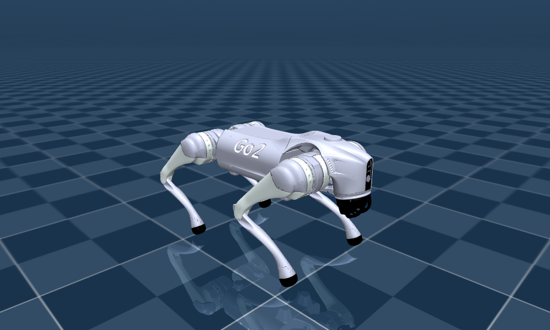

# 验收结果

环境：Ubuntu 26.04 (WSL2) / Python 3.14.4 / MuJoCo 3.12.0 / ROS 2 **Lyrical Luth** / CPU 单环境
模型：`models/go2/scene.xml`（unitree_mujoco 官方 Go2 MJCF，12 个 `<motor>` 力矩执行器）

## 复现

    # UDP 后端（不需要 ROS 2）
    .venv/bin/python scripts/verify.py

    # ROS 2 后端（sim 与 controller 是两个独立进程，走 rclpy + CycloneDDS）
    source /opt/ros/lyrical/setup.bash
    source ros2_ws/install/setup.bash
    export PYTHONPATH=$PYTHONPATH:/usr/lib/python3/dist-packages
    export ROS_DOMAIN_ID=1 RMW_IMPLEMENTATION=rmw_cyclonedds_cpp
    .venv/bin/python scripts/verify.py --transport ros2

## 结果

### A. ROS 2 后端：16/16 通过

    1. 消息层
       LowCmd 524 B / LowState 684 B；CRC32 与宇树 crc32_core 的逐位参考实现逐位一致
    2. IMU（站定后）
       |a| = 9.809 m/s^2, a = [0.045, -0.010, 9.809]；|w| = 0.0017 rad/s；foot_force = [35,35,39,39]
    3. 单进程 loopback，PD 站立
       max tilt = 4.3°，mean z = 0.258 m；不限速吞吐 3413 Hz
    4. 双进程 ROS 2（500 Hz）
       sim 收到指令 1771 帧，controller 收到状态 1781 帧
       看门狗 0 次误触发，RTF = 1.00，p95 周期抖动 4.7 ms
       **机器人站住：max tilt 0.9°，mean z 0.266 m**

### B. 这两个话题是真·ROS 2 话题（不是自己造的名字）

仿真在跑的时候，另开一个终端：

    $ ros2 topic list
    /parameter_events
    /rosout
    /rt/lowcmd
    /rt/lowstate

    $ ros2 topic info /rt/lowstate -v
    Type: unitree_go/msg/LowState
    Publisher count: 1
    Node name: go2_bridge
    Topic type hash: RIHS01_db5172cac933e3cfc0e705903343eb4eea42e65e224e9d726d3e672aec0caf0f
    QoS: RELIABLE / KEEP_LAST(10) / VOLATILE

    $ ros2 topic hz /rt/lowstate
    average rate: 498.177        ← 目标 500 Hz

话题名、消息类型、类型哈希都来自 unitree_ros2 官方定义，和真机上的那条低层通道是同一个。

### C. 数值怎么读

* **RTF = 1.00** 是"被限速到墙钟"的结果（`Pacer` 每步睡到 2 ms）。真正的余量看
  **不限速吞吐 3413 Hz**：物理一步 0.023 ms，加 LowState 打包 + 发布后整环仍有 6~7 倍余量。
* **498 Hz / p95 抖动 4.7 ms**：ROS 2 + CycloneDDS 在这台 WSL2 机器上跑 500 Hz 完全够用。
  真机上要更稳需要 `PREEMPT_RT` 或至少把仿真进程绑核。
* **看门狗 0 次触发**：`hold_until_first_cmd` 把"仿真先起来、控制器后连上"的空窗期
  单独记账（`n_warmup_ticks`），不混进"丢失指令"的统计。

### D. 可视化（`--viewer` 同款模型，离屏渲染）

    命令：timeout 60 python scripts/run_sim.py --viewer --duration 4
    RTF = 1.00，p95 lag = 6.1 ms，final: z = 0.2689 m，tilt = 0.35°，upright = true

图里的姿态就是"仿真侧只收 LowCmd（12 个 tau / kp·q_des / kd·dq_des）、由 500 Hz 电机层施加"
之后的物理后果。

## 后端状态总览

| 后端 | 状态 | 说明 |
|---|---|---|
| `loopback` | ✅ 已验证 | 单进程 |
| `udp` | ✅ 已验证 | 双进程裸 UDP，报文语义/CRC 与 DDS 一致 |
| `ros2` | ✅ **已验证** | rclpy + rmw_cyclonedds_cpp，话题 `rt/lowcmd` / `rt/lowstate` |
| `dds` | ❌ 不可用（Python 3.14） | unitree_sdk2py 依赖的 cyclonedds Python 绑定在 Python 3.14 上 import 就崩，见 `docs/backend-notes.md` |

## 真机（Go2）切换清单

1. PC 有线网卡设 `192.168.123.xxx`，`ping 192.168.123.161` 通。
2. **先关掉机器人自带的运控服务**（MotionSwitcher 释放 sport mode），否则低层指令会被覆盖。
3. `export ROS_DOMAIN_ID=0`，网卡从 `lo` 换成实际网卡（`CYCLONEDDS_URI` 或 `setup.sh`）。
4. 同一份控制器代码直接跑。第一次务必把机器人吊起来，先 `--controller zero` 确认能收到状态。

**还没做的一件事**：真机上 `rt/lowcmd` 需要 CRC32，而 CRC 要按 CDR 序列化后的字节算；
rclpy 的 Python 消息拿不到那串字节。所以**仿真↔ROS 2 这条路不受影响**，
但真机那条要么用 C++ 的 unitree_ros2/unitree_sdk2（它们自己算 CRC），
要么在 Python 里手工按 LowCmd 的 CDR 布局拼一遍。这一点写在这里，别踩。
